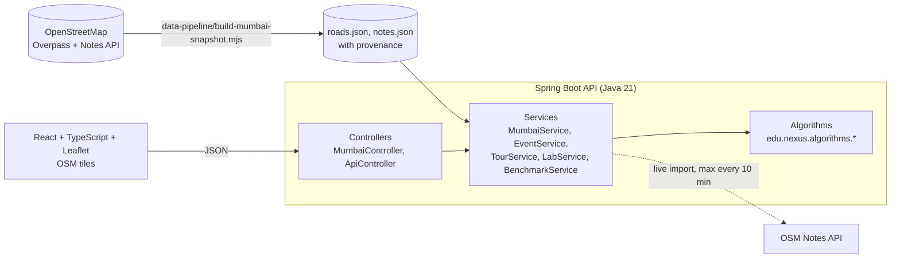

# NEXUS: Mumbai Network Intelligence

A student prototype that analyses the **real mapped arterial road network of Greater Mumbai** (OpenStreetMap):
connectivity, critical links, routes, multi-stop inspection tours and community map-issue records. All assessed
algorithms are implemented from scratch in Java; the React front end only displays API results.

**Live app:** https://nexus-resilience.onrender.com · **API docs:** https://nexus-resilience.onrender.com/swagger-ui.html
(free hosting: the first request after a quiet period can take 30-60 s while the server wakes up)

*Advanced Algorithms · CIA 3 · Semester V · 2026-27. Not an official, production or government system; it shows no live traffic.*

---

## What is real, what is estimated

| Data | Category | Source |
|---|---|---|
| Roads, intersections, one-way rules, names, lanes/maxspeed tags (12,907 nodes, 18,169 segments, ~2,478 km) | STATIC GEOGRAPHIC | OpenStreetMap via Overpass API, snapshot dated in `backend/src/main/resources/data/mumbai/roads.json` |
| 2,567 map notes (community-reported map issues, 2013 to the snapshot date) | LATEST AVAILABLE, or VERIFIED LIVE after an in-app import | OpenStreetMap Notes API |
| Segment travel time = length / speed (OSM `maxspeed`, else class default) | DERIVED ESTIMATE | computed in NEXUS |
| Segment capacity = lanes per direction x per-lane capacity by class | MODELLED PROXY | computed in NEXUS |
| Live traffic speeds or incidents | NOT AVAILABLE | no free, documented, terms-verified Mumbai feed was found (Google/TomTom/HERE need paid keys; no official public API) |
| Varunapuri-style toy graphs in the Algorithm Lab and tests | DEMONSTRATION | hand-made |

Map notes are **not** traffic incidents. Capacities are **not** measured throughput. The app labels both everywhere they appear.

## Screens and algorithms

| Screen | What you do | Algorithms (Java) |
|---|---|---|
| Overview | Study area, graph size, data sources, freshness | - |
| Network Explorer | Click A and B for the shortest (real length) or fastest (estimated) route; click a road to inspect its attributes | Dijkstra with a custom **Fibonacci heap**, compared on every query with `java.util.PriorityQueue` |
| Critical Links | Pick an area, click source and sink, optionally remove roads; see the bottleneck | **Edmonds-Karp** (BFS) and **Ford-Fulkerson** (DFS) on the same graph, **max-flow / min-cut** certificate |
| Network Health | Connected components in an area (before/after removals); map-note records, statistics, live import | **DSU**, **red-black tree** (time index), **Bloom filter** + exact id set, **segment tree** (notes per day), **randomized Quickselect** (P50/P90 time to close) |
| Multi-stop Planner | Click up to 15 stops; get a tour and its executable road route | **Metric-TSP 2-approximation** (MST + preorder) on Dijkstra road distances |
| Algorithm Lab & Benchmarks | Run each algorithm on your own input; benchmarks at three sizes; live self-check | all of the above |

## Graph model

* **Nodes** are OSM nodes shared by two or more selected ways, or way endpoints. **Segments** are the road pieces between
  consecutive nodes. Only `motorway` to `tertiary` roads (and links) are included; residential and service roads are not.
* A two-way segment gives two directed arcs; a one-way segment (`oneway=yes/-1`, roundabouts, motorways) gives one.
* Each segment keeps **three separate quantities**: length (m, static), travel time (s, derived), capacity (veh/h per direction, proxy).
* Routes use the directed graph. Components use an undirected view. Flow uses directed arcs with the capacity proxy.
  The TSP uses a symmetric planning matrix D(i, j) = max(d(i→j), d(j→i)) over directed road distances; it satisfies the
  triangle inequality and upper-bounds travel in both directions. The executable route expands each leg into its directed shortest path.

## Architecture



## Run locally

Prerequisites: Java 21+, Maven 3.9+, Node 20+.

```bash
cd backend && mvn spring-boot:run            # API on http://localhost:8080
cd frontend && npm install && npm run dev    # app on http://localhost:5173 (proxies /api)
```

If port 8080 is busy: `PORT=8090 mvn spring-boot:run` and `API_PROXY=http://localhost:8090 npm run dev`.
Single container: `docker build -t nexus . && docker run -p 8080:8080 nexus`.

## Refresh the data

```bash
node data-pipeline/build-mumbai-snapshot.mjs            # fetches Overpass + OSM Notes, rebuilds the snapshot
node data-pipeline/build-mumbai-snapshot.mjs --offline  # rebuilds from cached raw downloads
```

The Overpass query, study-area bounding box, class defaults and per-lane capacities are at the top of the script and are
copied into the snapshot's provenance. The pipeline sends one request to each service with an identifying User-Agent.

## Tests and benchmarks

```bash
cd backend && mvn verify                                   # 76 JUnit tests
cd frontend && npm run lint && npm run typecheck && npm run build
```

Every assessed algorithm has at least five tests (edge cases, invalid input, seeded property tests against independent
oracles: `TreeMap`, `PriorityQueue`, Floyd-Warshall, full sort, Held-Karp, plain arrays). Service tests run on the committed
Mumbai snapshot, so they are deterministic and need no network. Benchmarks (`POST /api/benchmarks/{suite}`, or the Lab page)
use three input sizes, warm-up, the median of repeated runs, and a baseline; recorded runs are in `docs/benchmark-results.md`.

## Configuration

| Variable | Default | Purpose |
|---|---|---|
| `PORT` | 8080 | set by Render |
| `CORS_ALLOWED_ORIGINS` | localhost:5173 | only needed if the front end is hosted on another origin |
| `MAX_REQUEST_BYTES` | 2097152 | request size limit |
| `MAX_AREA_SEGMENTS` / `MAX_FLOW_SEGMENTS` | 20000 / 6000 | graph-size limits per request |

No secrets are needed. Deployment: see [docs/deployment.md](docs/deployment.md) (Render blueprint in `render.yaml`).

## Limitations

* No live traffic, travel-time history or measured capacities. Routes are free-flow estimates; flows are on a capacity model.
* Arterial roads only, so some areas show small "components" that are really connected through residential streets or roads outside the selected box.
* The min cut is a property of the capacity model; it does not predict real disruption impact.
* Map notes are community map-maintenance reports with uneven coverage; they are not incident data.
* The Fibonacci heap has better amortized bounds but was **slower** than `PriorityQueue` in our benchmarks (constant factors).

## Documents

[Proposal](docs/proposal.md) · [Technical report](docs/technical-report.md) · [API](docs/api.md) · [Deployment](docs/deployment.md) ·
[Benchmark results](docs/benchmark-results.md) · [Demo script](docs/demo-script.md) · [Viva questions](docs/viva-questions.md)

## Credits and licence

Map data © OpenStreetMap contributors, ODbL 1.0 (https://www.openstreetmap.org/copyright); base map tiles © OpenStreetMap.
References: CLRS *Introduction to Algorithms*; Fredman & Tarjan (1987) Fibonacci heaps; Edmonds & Karp (1972);
Kirsch & Mitzenmacher (2006); Rosenkrantz, Stearns & Lewis (1977). Code licensed MIT (see LICENSE).
