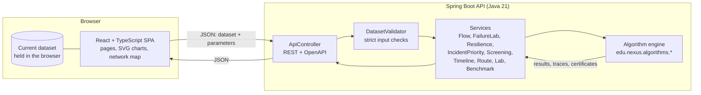

# NEXUS: Infrastructure Failure & Resilience Simulator

> When a bridge fails, who loses relief, and what should be repaired first?

NEXUS models a city's relief depots, junctions, demand zones and roads as networks. It **proves** how much aid the network
can deliver, **stress-tests** it against failures, and **ranks recovery actions** by the delivery capacity they win back.
Every assessed algorithm is implemented from scratch in Java; the React front end only displays API results.

*Advanced Algorithms · CIA 3 · Semester V · 2026-27. All bundled data is **synthetic**: Varunapuri is a fictional city.
Results are decision support for an academic project, not official instructions.*

---

## What it does

| Workflow | Question it answers | Algorithms |
|---|---|---|
| **Failure Lab** (flagship) | A road or facility fails: how much throughput is lost, which zones are cut off, which hours are worst, how bad is it compared with random failures, and which repair helps most? | Edmonds-Karp + min cut, DSU, segment tree, randomized Quickselect |
| Flow Optimizer | What is the maximum deliverable flow, which roads are the bottleneck, and how did the solver get there? (step-by-step replay) | Edmonds-Karp, Ford-Fulkerson, min cut |
| Infrastructure Resilience | Which parts of the city stay physically connected? Which single roads are critical? | Disjoint-set union |
| Incident Priority | Which open incident should be handled next as reports change? | Red-black tree |
| Duplicate Screening | Is this incident report a duplicate? | Bloom filter + exact verification |
| Delivery Routes | A short tour for one relief vehicle, with a proven quality bound | Metric TSP 2-approximation (MST + preorder) |
| Algorithm Lab | Run each algorithm on your own small input and inspect the trace | all |
| Benchmarks & Tests | Live property checks and benchmarks with baselines | all |

## Algorithms (all in `backend/src/main/java/edu/nexus/algorithms`)

| Family | Class | Time | Space | Syllabus |
|---|---|---|---|---|
| Network flow: Edmonds-Karp (BFS) | `flow/EdmondsKarp` | O(V E²) | O(V+E) | Unit 5 |
| Network flow: Ford-Fulkerson (DFS) | `flow/FordFulkerson` | O(E·\|f*\|), integer capacities | O(V+E) | Unit 5 |
| Max-flow / min-cut certificate | `flow/MinCut` | O(V+E) | O(V) | Unit 5 |
| Disjoint-set union | `dsu/DisjointSetUnion` | O(α(n)) amortized | O(n) | Unit 2 |
| Red-black tree (+ subtree sizes) | `rbtree/RedBlackTree` | O(log n) | O(n) | Unit 3 |
| Bloom filter | `bloom/BloomFilter` | O(k) | m bits | Unit 6 (CO5) |
| Segment tree (lazy range add) | `segtree/SegmentTree` | O(log n) per op | O(n) | Unit 3 |
| Randomized Quickselect | `select/RandomizedQuickselect` | expected O(n) | O(1) extra | Unit 1/6 (CO5) |
| Metric TSP 2-approximation | `tsp/MstPreorderTsp` | O(n²) | O(n²) | Unit 5 |

Ford-Fulkerson, Edmonds-Karp and min cut are **one technique family** (network flow), not three separate algorithms.
Supporting (non-assessed) code: Dijkstra (`graph/ShortestPaths`) to build road distances, nearest-neighbour and
Held-Karp TSP as a baseline and test oracle.

## Architecture



* **Stateless API.** The browser sends the dataset with every request, so many people can use one deployment at once without interfering.
* **Three separate graphs.** Directed capacity network (flow), undirected connectivity graph (DSU), metric distance matrix (TSP).
  Road `capacity` (kits per 12 h, per direction) and `lengthKm` (distance) are never mixed.
* **Single deployable.** The Docker image bundles the built website into the API, so one Render service hosts everything.

## Quick start (local development)

Prerequisites: **Java 21+**, **Maven 3.9+**, **Node 20+**.

```bash
# 1. API on http://localhost:8080 (Swagger UI at /swagger-ui.html)
cd backend
mvn spring-boot:run

# 2. Website on http://localhost:5173 (proxies /api to the API)
cd frontend
npm install
npm run dev
```

If port 8080 is busy, start the API with `PORT=8090 mvn spring-boot:run` and the website with `API_PROXY=http://localhost:8090 npm run dev`.

Single container: `docker build -t nexus . && docker run -p 8080:8080 nexus`, then open http://localhost:8080.

## Tests

```bash
cd backend && mvn verify          # 62 JUnit tests: algorithms, services, HTTP integration
cd frontend && npm run lint && npm run typecheck && npm run build
```

Each core algorithm has at least five documented tests including boundary and invalid-input cases, plus seeded property tests
against oracles (`TreeMap`, plain arrays, full sort, Held-Karp, naive relabelling). See [docs/test-evidence.md](docs/test-evidence.md).
The deployed site also has a **live self-check** (Benchmarks & Tests page) that re-runs about 10,000 seeded cases on the server.

## Deployment (public HTTPS)

See [docs/deployment.md](docs/deployment.md). Summary: push this repository to GitHub, then on Render choose
**New → Blueprint** and select the repository. `render.yaml` builds the Dockerfile (website + API) on the free plan and
health-checks `/api/health`. Optional: host the front end separately on Vercel (`frontend/vercel.json`) with
`VITE_API_BASE_URL` set to the Render URL, and add the Vercel origin to `CORS_ALLOWED_ORIGINS`.

Environment variables (no secrets are needed):

| Variable | Where | Purpose |
|---|---|---|
| `PORT` | API | set by Render automatically |
| `CORS_ALLOWED_ORIGINS` | API | comma-separated origins allowed to call the API (only for a separately hosted front end) |
| `MAX_REQUEST_BYTES` | API | request body limit (default 2 MiB) |
| `VITE_API_BASE_URL` | front end build | API URL when the front end is hosted separately; empty = same origin |

## API examples

```bash
API=http://localhost:8080
curl $API/api/health
curl $API/api/dataset/demo > city.json

# Max flow with Ford-Fulkerson comparison and a trace
curl -X POST $API/api/flow/optimize -H 'Content-Type: application/json' \
  -d "{\"dataset\": $(cat city.json), \"algorithm\": \"COMPARE\"}"

# Failure Lab: wash out causeway R22
curl -X POST $API/api/failure-lab/simulate -H 'Content-Type: application/json' \
  -d "{\"dataset\": $(cat city.json), \"failedRoadIds\": [\"R22\"], \"batchScenarios\": 100, \"seed\": 2026}"

# Algorithm Lab: max flow on your own graph
curl -X POST $API/api/lab/flow -H 'Content-Type: application/json' \
  -d '{"nodes":["s","a","b","t"],"edges":[{"from":"s","to":"a","capacity":3},{"from":"a","to":"t","capacity":2},{"from":"s","to":"b","capacity":2},{"from":"b","to":"t","capacity":3}],"source":"s","sink":"t"}'
```

Full reference: [docs/api.md](docs/api.md) and the live Swagger UI at `/swagger-ui.html`.

## Repository layout

```
backend/    Spring Boot API: algorithms/, service/, dto/, model/, web/, config/, tests, demo dataset
frontend/   React + TypeScript + Vite single-page app
docs/       proposal, technical report, API, deployment, demo script, viva Q&A, pitch, evidence
Dockerfile  website + API in one image          render.yaml   Render blueprint
.github/workflows/ci.yml  Java tests, front-end lint/typecheck/build, Docker build
```

## Assumptions and limitations

* Max flow is single-commodity and single-period. It maximises total delivered units in a 12-hour window; it does not model
  travel time, vehicle schedules, perishability or fairness. It is not a full multi-depot inventory optimiser.
* The incident score is a transparent triage rule, not a validated risk model.
* Hourly capacity in the Failure Lab assumes deliveries are spread evenly across the window.
* Route planning assumes one vehicle, no capacity or time windows, and that convoys may use any operating road in either direction.
* The Bloom filter is insertion-only (no deletions), so false negatives cannot occur; false positives are always verified exactly.
* Benchmarks depend on hardware; the free hosting tier is slow and shared, so compare growth rates and operation counts.

## Documents

[Proposal](docs/proposal.md) · [Technical report](docs/technical-report.md) · [API](docs/api.md) ·
[Deployment](docs/deployment.md) · [Benchmark results](docs/benchmark-results.md) · [Test evidence](docs/test-evidence.md) ·
[8-minute demo script](docs/demo-script.md) · [Viva questions](docs/viva-questions.md) · [Product pitch](docs/pitch.md)

## Credits

Algorithms follow standard references: Cormen, Leiserson, Rivest and Stein, *Introduction to Algorithms* (red-black trees,
max flow, approximation algorithms); Kirsch and Mitzenmacher (2006) for Bloom-filter double hashing; Rosenkrantz, Stearns
and Lewis (1977) for the MST-based TSP bound. Third-party software: Spring Boot, springdoc-openapi, React, Vite, TypeScript,
ESLint (see their licences). No third-party library performs any assessed algorithm.

Licensed under the MIT License (see [LICENSE](LICENSE)).
